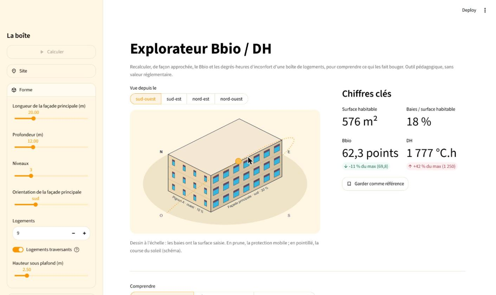

# Explorateur Bbio / DH

Outil pédagogique qui recalcule, de façon simplifiée et approchée, le **Bbio** et les **degrés-heures d'inconfort
(DH)** de la RE2020, en suivant la logique de la méthode Th-BCE 2020. Il s'adresse aux architectes et aux ingénieurs,
étudiants ou débutants, pour comprendre et discuter l'inconfort d'été et la RE2020.

**Ce n'est pas un logiciel réglementaire.** Il n'est pas évalué au sens de l'annexe V de l'arrêté du 4 août 2021 et
ses résultats ne peuvent pas servir à une attestation. Cible : un Bbio à ± 10 % d'une étude réglementaire.

Version en cours : voir `VERSION` et `CHANGELOG.md`. Suite prévue : `ROADMAP.md`.

## Interface

```powershell
streamlit run app.py
```

puis ouvrir http://localhost:8501.



La page s'ouvre sur un **accueil** (à quoi sert l'outil, trois notions, limites, liens) ; le bouton « Explorer la
boîte » ou « Calculer » ouvre la page de travail.

1. **Décrire** une boîte de logements dans le menu de gauche, en partant d'un logement de 70 m² ou d'un immeuble
   de 9 logements (site, forme, baies et balcons, parois, air, confort d'été) : elle se dessine aussitôt en
   axonométrie.
2. **Calculer** : le bouton lance le calcul choisi, DH (par défaut), Bbio ou les deux, heure par heure sur une
   année chacun (quelques secondes par calcul).
3. **Comprendre** : les résultats se lisent par briques : le phénomène, un graphique, des ordres de grandeur et
   l'équation avec ce qu'elle dit ; puis, dans un volet, sa référence et le code du moteur. Les mots techniques
   renvoient au [Glossaire du confort dans le bâtiment](https://guillaume-meunier.notion.site/2446562e29cd80a99195f07beeade7c3).
4. **Comparer** : les chiffres clés montrent l'écart avec le calcul précédent ; « Garder comme référence »,
   changer une saisie, recalculer : la page montre ce qui a changé et l'écart sur chaque indicateur.

Les textes de l'interface (accueil, aide de chaque saisie, termes du glossaire) sont dans `interface/textes/`,
modifiables sans toucher au code.

### Mise en ligne

L'interface est prête pour Streamlit Community Cloud (ou tout hébergeur qui lance `streamlit run app.py`) : dépôt
`Alliages/explorateur_Bbio_DH`, fichier `app.py`, Python 3.11, dépendances de `requirements.txt`, thème de
`.streamlit/config.toml`. Aucun secret, aucune donnée hors du dépôt : la météo, les scénarios et les hypothèses
sont dans `donnees/` (7 Mo). La page garde en mémoire les 24 derniers calculs (0,7 Mo chacun). La mise en ligne
elle-même se fait sur demande explicite (voir `ROADMAP.md`).

## État (0.9.0)

Socle (structures de projet, calendrier conventionnel, fichiers météo, scénarios du logement collectif), module
solaire (rayonnement et éclairement reçus par une paroi orientée, masques, flux transmis par les baies et les parois
opaques), modèle thermique horaire du groupe (réseau RC de la fiche 5.21) et besoins de chauffage, de
refroidissement et d'éclairage d'un groupe (apports internes, émetteur conventionnel, saisons, lumière naturelle),
Bbio d'un projet par groupe, zone et bâtiment, comparé au Bbio max des logements collectifs, protections mobiles
des baies (volets, stores enroulables), ouverture des baies pour la surventilation naturelle, infiltrations par
les défauts d'étanchéité, et degrés-heures d'inconfort d'été (DH) sur l'année caniculaire, brasseurs d'air compris,
comparés au DH max.
Sur cinq études réglementaires, le chauffage est 2 à 26 % trop faible et le besoin de froid 1,7 à 4 fois trop
fort : le Bbio calculé s'approche de celui d'une étude sans lui être encore comparable. Le DH va de 41 % sous
les études à 28 % au-dessus. L'interface permet d'essayer une boîte de logements de bout en bout : la décrire, la
calculer, comprendre le résultat et comparer deux variantes.

L'outil sait lire le fichier XML d'une étude réglementaire (RSET) et refaire son Bbio et son DH pour les comparer :

```powershell
python -m outils.comparer_reference "_sources\mon_etude.xml" --variantes
python -m outils.comparer_reference "_sources\mon_etude.xml" --dh
```

Et passer toutes les études d'un ou plusieurs dossiers d'un coup (table dans `_resultats\validation.csv`) :

```powershell
python -m outils.valider "..\_RSEE" "_sources" --dh
```

Et, pour les études dont on a les sorties horaires d'un moteur Th-BCE (`..\_RSEE\Horaires`), comparer heure par
heure (tables dans `_resultats\horaires\`) :

```powershell
python -m outils.comparer_horaires tous
```

## Premier calcul

Après l'installation (ci-dessous), depuis la racine du dépôt :

```python
from moteur.bbio import calculer_bbio
from moteur.dh import calculer_dh
from moteur.structures import Baie, Batiment, Groupe, Paroi, Projet, Zone

# Un groupe : cinq logements de 60 m², traversants, volets manuels et fenêtres ouvrables
baies = [Baie(nom, 20.0, orientation, uw=1.4, sw_e=0.5, tl=0.6,
              protection="volet", uw_protege=1.1, sw_protege=0.1,
              ouvrable=True, ratio_ouverture_max=0.6)
         for nom, orientation in (("Baies sud", 0), ("Baies nord", 180))]
groupe = Groupe("Logements", 300.0, nb_logements=5, debit_ventilation_m3h=300.0, traversant=True,
                parois=[Paroi("Mur sud", "mur", 150.0, u=0.25, orientation_deg=0, alpha=0.6),
                        Paroi("Toiture", "toiture", 100.0, u=0.15, alpha=0.6)],
                baies=baies)
projet = Projet("Essai", "H3", altitude_m=50.0,
                batiments=[Batiment("Bâtiment", zones=[Zone("Zone", groupes=[groupe])])])

bbio = calculer_bbio(projet)        # mode Th-B, climat moyen : 1 à 2 s par groupe
print(bbio.groupes[["groupe", "b_ch", "b_fr", "b_ecl", "bbio", "bbio_max"]].round(1))

dh = calculer_dh(projet)            # mode Th-D, année caniculaire : 2 à 3 s par groupe
print(dh.groupes[["groupe", "dh", "dh_max", "respecte", "avertissement"]].round(0))
```

Résultat attendu : Bbio de 34,3 points pour un maximum de 73,5 ; DH de 1 978 °C.h pour un maximum de 1 250.

- Orientation : 0 = sud, 90 = ouest, ± 180 = nord, − 90 = est. Les champs de chaque objet sont décrits dans
  `moteur/structures.py`.
- `bbio.zones`, `bbio.batiments` et `bbio.mensuel` donnent les autres niveaux ; `bbio.horaire` et `dh.horaire`
  donnent les 8 760 heures de chaque groupe (températures, flux, saisons, protections, ouvertures).
- La colonne `avertissement` du DH signale un groupe sans protection mobile ou sans baie ouvrable : son DH n'a
  alors pas de sens.

## Installation (Windows, PowerShell)

```powershell
git clone https://github.com/Alliages/explorateur_Bbio_DH.git
cd explorateur_Bbio_DH
python -m venv .venv
.\.venv\Scripts\Activate.ps1
pip install -r requirements.txt
python -m pytest
```

## Organisation

| Dossier | Contenu |
|---|---|
| `moteur/` | Calcul, sans aucune dépendance à l'interface |
| `app.py`, `interface/` | Interface Streamlit : saisie d'une boîte, axonométrie, briques pédagogiques (`interface/briques/`), comparaison de deux variantes |
| `donnees/` | Météo, scénarios, hypothèses et niveaux d'enveloppe des logements (CSV : séparateur `;`, virgule décimale, UTF-8) ; `donnees/batiments/` : un CSV par bâtiment de départ (format dans son `README.md`) |
| `config/` | Chemins, formats et listes |
| `outils/` | Préparation des données, lecture d'une étude (RSET) et comparaison à ses résultats ; `outils/typologies/` : niveaux d'enveloppe tirés des études |
| `tests/` | Tests automatiques |
| `docs/` | Journal d'audit, note de passation, capture de l'interface et graphique des niveaux d'enveloppe |

Modules du moteur, dans l'ordre du calcul (chaque fichier commence par ses sources et un schéma) :

| Module | Rôle |
|---|---|
| `structures.py` | Description d'un projet : bâtiment, zone, groupe, parois, baies, brasseurs d'air |
| `hypotheses.py`, `meteo.py`, `calendrier.py`, `scenarios.py` | Constantes sourcées, fichiers météo, calendrier conventionnel, scénarios d'occupation |
| `solaire.py`, `masques.py`, `enveloppe.py` | Rayonnement reçu par une paroi, masques, coefficients de transmission |
| `apports.py`, `eclairage.py` | Apports internes, lumière naturelle et éclairage |
| `protections.py`, `ouvertures.py`, `infiltrations.py` | Protections mobiles, ouverture des baies, défauts d'étanchéité |
| `brasseurs.py`, `confort.py` | Brasseurs d'air ; confort adaptatif (période, seuil de confort chaud) |
| `groupe.py` | Modèle thermique horaire du groupe (réseau RC) |
| `besoins.py` | Année heure par heure : besoins (mode Th-B) ou températures de l'année caniculaire (mode Th-D) |
| `bbio.py`, `dh.py` | Bbio et Bbio max ; degrés-heures et DH max d'un projet |

Données locales, **jamais dans le dépôt** : les études RE2020 de projets réels (RSEE), rangées à côté du dépôt dans
`../_RSEE`, et tout dossier dont le nom commence par `_`, dont `_references/` (classeurs
officiels). Un test échoue si l'un de ces fichiers est suivi par git.

## Sources

- Arrêté du 4 août 2021, annexe III (méthode Th-BCE 2020) et annexe IV (règles Th-Bat 2020).
- Code de la construction et de l'habitation, annexe à l'article R. 172-4 (exigences : Bbio max et DH max),
  version du décret n° 2026-200 du 18 mars 2026.
- Classeur « scénarios conventionnels » de la RE2020, version du 29/04/2026.
- Classeur « scénarios météorologiques Th-BC / Th-D » de la RE2020 (DHUP, données Météo-France 2000-2018).

Chaque constante du moteur est citée avec sa source dans `donnees/hypotheses.csv`. Les lectures du texte et les
hypothèses propres à l'outil sont numérotées dans `docs/audit.md` ; deux d'entre elles pèsent sur le DH et restent
à valider : la ventilation du calcul d'été, prise sans échangeur (75), et la catégorie de contraintes extérieures
du DH max, déduite d'études faute du chapitre V de l'annexe (76).

### Fichiers météo

Les fichiers de `donnees/meteo/` sont extraits du classeur officiel, dont la présentation indique que ces données
« ne peuvent être utilisées que pour le calcul réglementaire de la performance énergétique des bâtiments ». Leur
usage dans un outil pédagogique fait l'objet d'une demande d'accord auprès de la DHUP, à obtenir avant la version 1.0.

Pour régénérer les CSV : placer les deux classeurs dans `_references/`, puis

```powershell
python -m outils.extraire_donnees
```

## Licence

GPL 3 — voir `LICENSE`.
